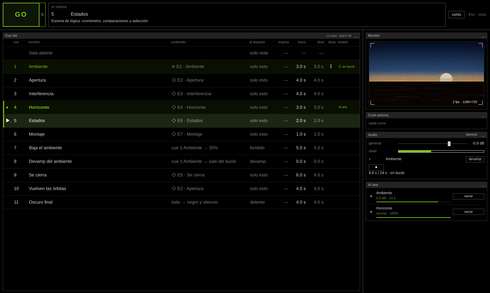
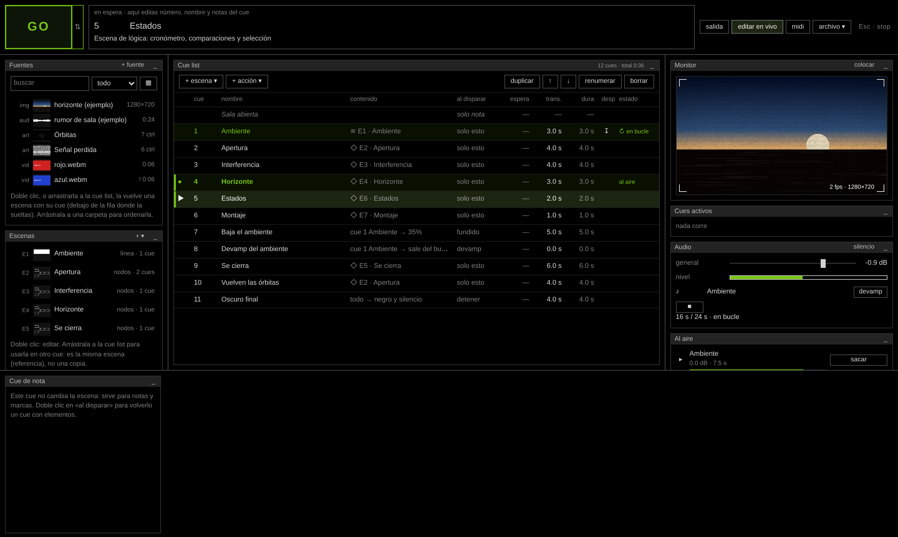
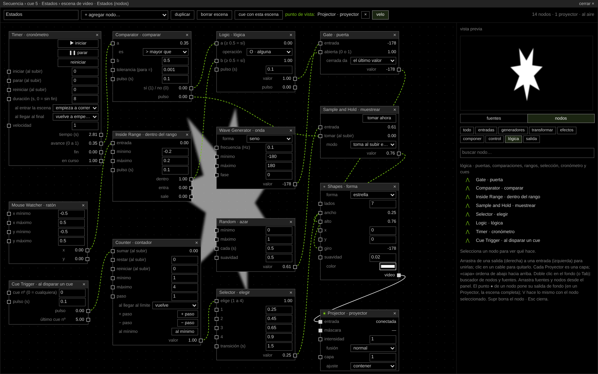
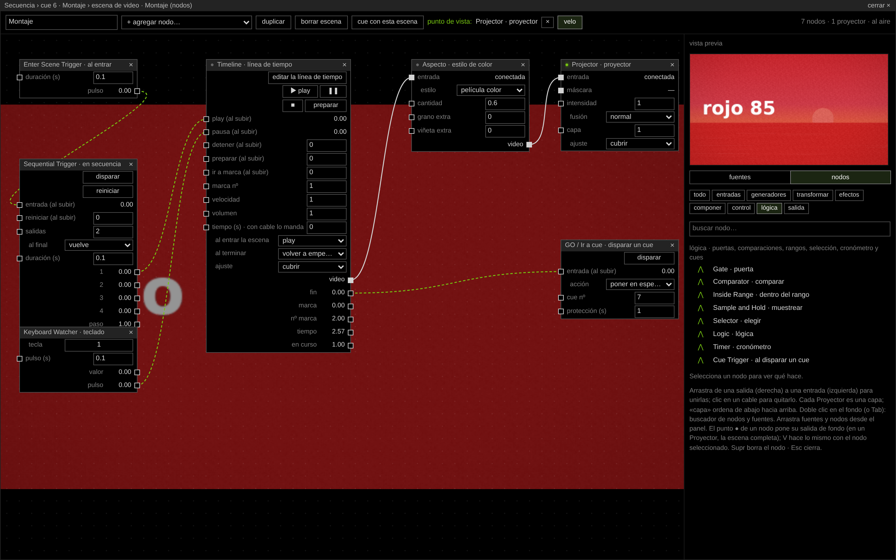
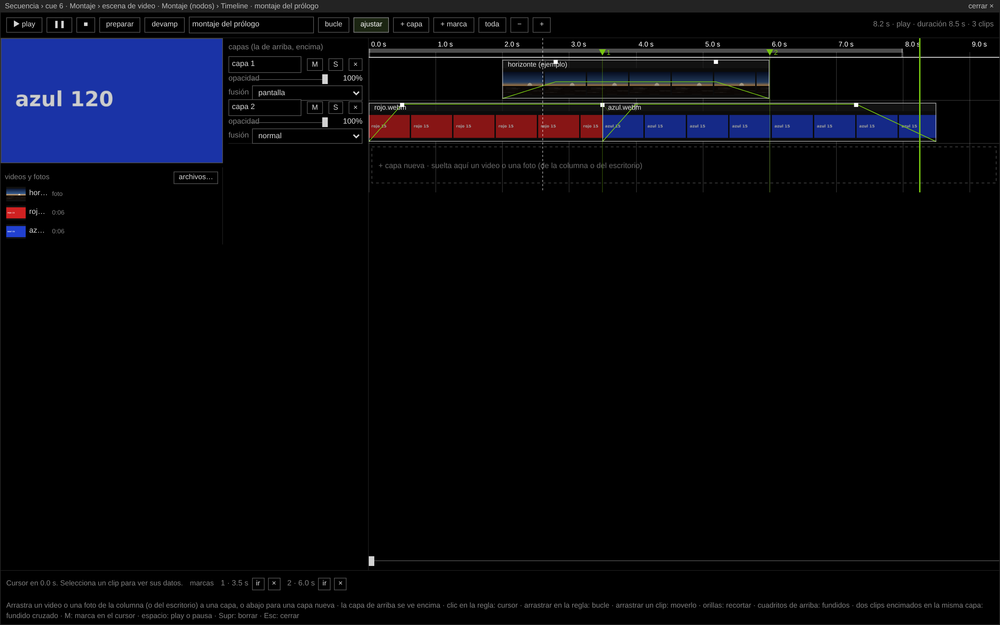
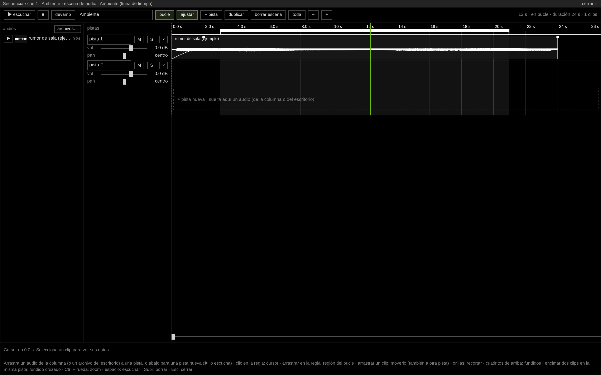
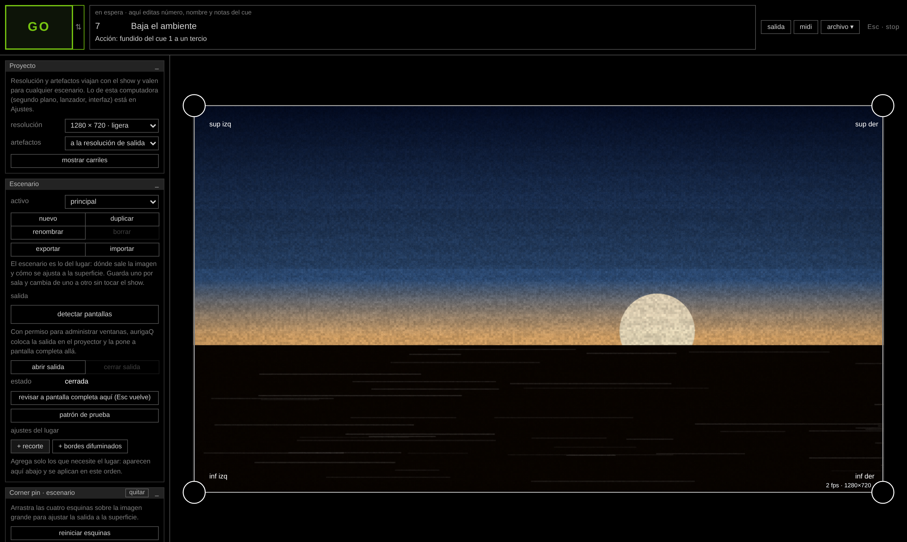
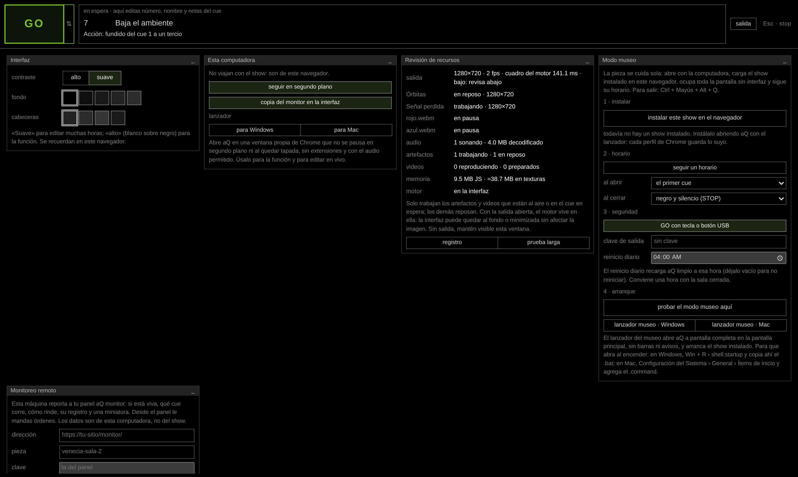

# aurigaQ (aQ)

**Versión 0.39 (v039)** · Alchemy of Meaning (Alquimia del Significado) · Héctor Cruz Juárez

## Español

aurigaQ es un media server y una cue list que corre en el navegador. Sirve para presentar en vivo artefactos web (instrumentos visuales y sonoros de la colección), video, foto, audio y cámaras, en teatro, danza, música, instalación y museo.

### Una herramienta que viene de la escena

aurigaQ es el resultado de más de una década y media de investigación en diseño multimedia y videoproyección para las artes escénicas, a lo largo de más de cien producciones en distintos países. Esa práctica dejó preguntas concretas: qué necesita una función en vivo para no fallar, cómo se ensaya una imagen junto con un cuerpo y un texto, cómo se arma un dispositivo que un equipo pequeño pueda operar en una sala y otro pueda montar en un museo lejos del autor, y cómo se enseña todo eso en un taller.

La herramienta responde a esas preguntas con decisiones de diseño:

- **El paso de un cue a otro es la esencia de la función.** Todo se organiza en una lista que avanza con GO, con su transición y su comportamiento.
- **Estabilidad antes que efectos.** Límites puestos a propósito: 720p o 1080p, audio estéreo, recursos que solo trabajan cuando están al aire o en espera. Está pensada para la laptop de un taller.
- **Abierta y portátil.** Un solo archivo HTML, sin instalación ni internet, con licencia libre.

### Qué hace

**Cue list y función.** Cada cue presenta una escena o hace una acción sobre lo que está sonando o al aire: fundido, detener, pausar, reanudar, devamp, disparar, ir a, esperar. Los estados de cada cue se ven de un vistazo: al aire, entrando, en bucle o en pausa. Las escenas se reusan por referencia.

**Escenas de video con nodos.** Un patch de fuentes, transformaciones, efectos y composición que termina en uno o varios Proyectores, organizado en categorías: entradas, generadores, transformar, efectos, componer, control, lógica y salida. Los números se conectan entre nodos: ondas, azar, ratón, teclado, nivel de audio, disparos, contadores, comparaciones, puertas y cronómetros. Así una escena puede cambiar sola, responder al público o seguir a la cue list.

**Timeline de video y foto.** Un nodo con una línea de tiempo por capas: recortes, fundidos de entrada y de salida, cruces, opacidad y fusión por capa, marcas, bucle y devamp. Se prepara en su primer cuadro y se controla con disparos: al entrar la escena, en secuencia, con una tecla o al terminar.

**Escenas de audio.** Una línea de tiempo estéreo multipista con clips, recortes, curvas de volumen, fundidos cruzados, región de bucle y devamp, programada con el reloj de audio.

**Salida y escenario.** Ventana de salida para el proyector, con corner pin, recortes y bordes difuminados. Los escenarios guardan lo propio de cada sala sin tocar el show.

**Para museo y gira.** Modo museo sin internet con horario, reinicio diario y lanzadores; monitoreo remoto con panel propio; agente local que reabre la pieza y enciende los proyectores por red. Revisión de recursos para saber qué está trabajando.

**Artefactos.** Cualquier app web puede volverse artefacto con el protocolo `artefacto/v0` y el SDK incluido. Sus controles quedan como entradas de un nodo y viajan con el show.

### Cómo usarlo

1. Sube la carpeta completa a un servidor con HTTPS, junto a tus artefactos, o pruébala en local con `python3 -m http.server 8000` dentro de la carpeta. Luego abre `http://localhost:8000/`.
2. Ábrela en Chrome o Edge y abre la ventana de salida en el proyector.
3. El manual completo está en `LEEME.txt`. Para hacer artefactos compatibles, consulta `PROTOCOLO.md`, `crear-artefacto-aurigaq.md` y `sdk/artefacto-sdk.js`.

Las capturas se tomaron en un navegador sin GPU, así que los cuadros por segundo que muestran no reflejan el rendimiento real.

## English

aurigaQ is a browser-based media server and cue list for performing web artefacts (visual and sound instruments from the collection), video, stills, audio and cameras live in theatre, dance, music, installation and museum settings.

It is the outcome of more than fifteen years of research in multimedia and projection design for the performing arts, across more than a hundred productions in several countries. The tool turns that practice into design decisions:

- the move from one cue to the next is the heart of a performance;
- stability comes before effects;
- everything runs offline from a single HTML file under a free licence.

**Features:**

- **Cues.** Every cue is a scene or an action.
- **Video scenes.** Node patches with generators, effects, compositing, numeric control and logic: comparators, gates, timers, selectors and cue triggers.
- **Video timeline node.** Layers, trims, fades, markers and trigger control.
- **Audio scenes.** Multitrack timelines with loop and devamp.
- **Output and venues.** A separate output window with corner pin, plus venue setups kept apart from the show.
- **Touring.** Museum mode with a schedule, remote monitoring and a local agent.

**Run it:** serve the folder over HTTPS or `localhost` and open it in Chrome or Edge. The full manual (in Spanish) is in `LEEME.txt`.

## Créditos · Credits

Diseño, investigación y desarrollo: Héctor Cruz Juárez — https://hectorcruz.com.mx  
Colección Alchemy of Meaning (Alquimia del Significado).

## Licencia · License

GPL-3.0-or-later. Ver `LICENSE`.
